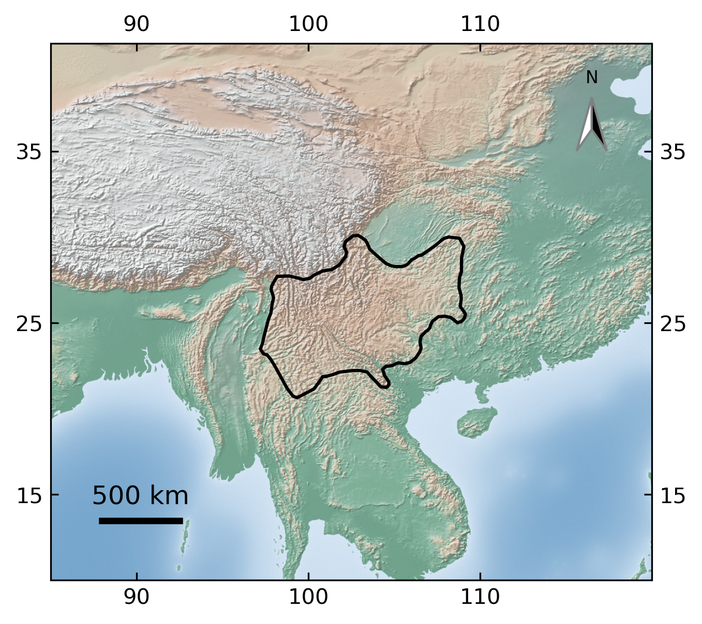
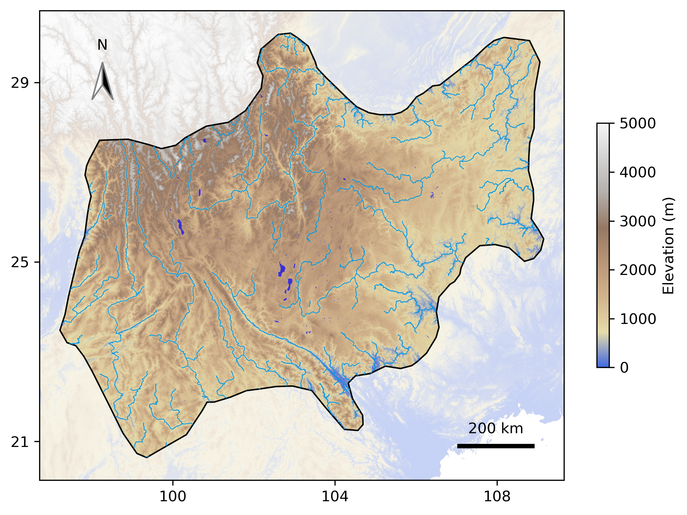
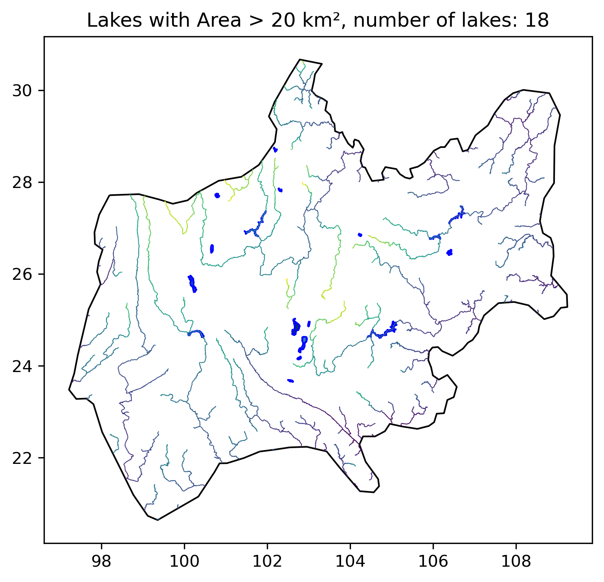
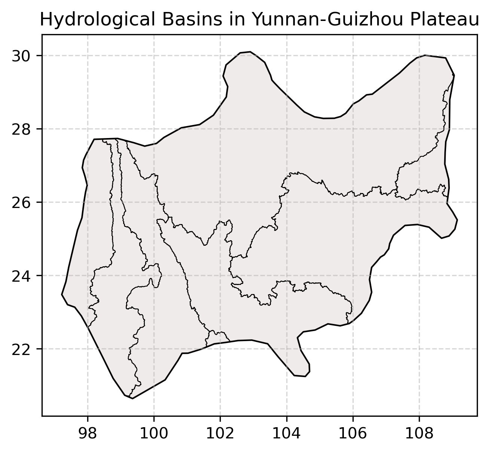

# Yunnan-Guizhou-Plateau

## Study region:

|  |  |
| --------------------- | ----------------- |

|  |  |
| --------------------------------- | ------------------------ |

TODO:
1. download ygp rsimg from gee (data-down/rsimg-down-gee/1_s2_down_TODO.ipynb)(hu, ref: https://github.com/Hydrological-Observation-Group/hma-water/blob/main/data_down/4_rsimg_down_gee.ipynb)       
2. downloading ygp swot raster data, add code to data-down/2_swot_raster_down.ipynb, and add data to data/swot/raster (xu, ref: https://github.com/xinluo2018/Yunnan-Surface-Water/blob/main/notebooks/1_2_swot_data_down.ipynb)      
3. 卫星测高在云贵高原水位监测中研究进展    
4. 深度学习在云贵高原水体提取中研究进展    

